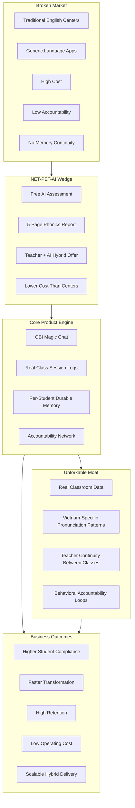
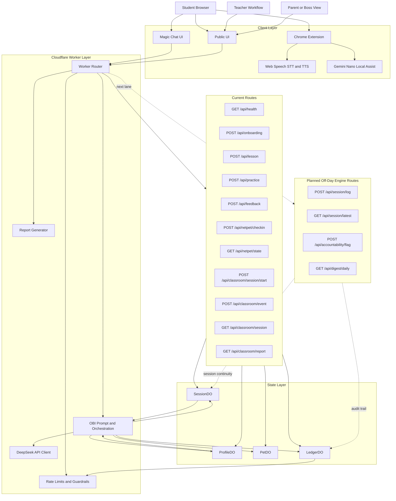
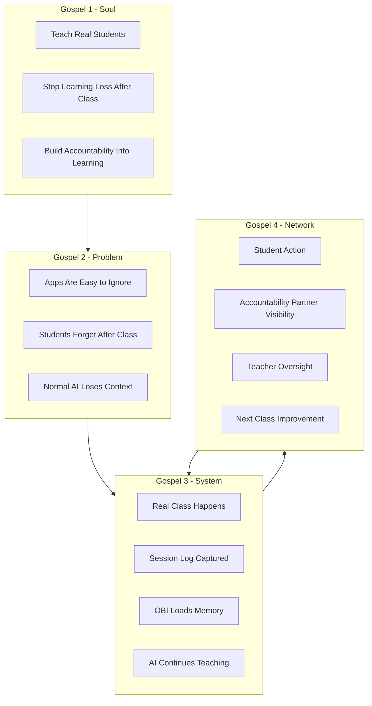

# NET-PET-AI Architecture Diagrams

This document expresses the same system in four views:

1. Investor-grade value architecture
2. Student-facing product experience
3. Strict engineering architecture with APIs and data flow
4. Gospel 444 operating model

## 1. Investor-Grade Diagram

## 2. Student-Facing Product Diagram

```mermaid
flowchart LR
    A[Student Sees Free Assessment] --> B[AI Diagnostic on 42 Sounds]
    B --> C[Receives Progress Report]
    C --> D[Starts Human Class With Michael]
    D --> E[Gets OBI Daily Homework Companion]

    subgraph DailyLoop[1-Hour Lifestyle]
        E --> F[45 Minutes Listening]
        F --> G[OBI Tracks What Was Studied]
        G --> H[15 Minutes Speaking With OBI]
        H --> I[Instant Feedback and Encouragement]
        I --> J[Progress Stored in Memory]
    end

    J --> K[Student Comes Back to Next Class Prepared]
    K --> L[Confidence, Continuity, Better English]

    subgraph Support[Optional Accountability]
        S1[Parent Login]
        S2[Boss Login]
        S3[Partner Login]
    end

    J -. if enabled .-> Support
    Support -. reminders and visibility .-> K
```

## 3. Strict Engineering Architecture

## 4. Gospel 444 Operating Model

## Notes

- The engineering diagram separates current Worker routes from planned Off-Day Engine routes.
- The investor view emphasizes moat, scalability, and unit economics.
- The student view emphasizes felt experience rather than infrastructure.
- The Gospel 444 view keeps the system tied to Soul, Problem, System, and Network so the architecture does not drift into a generic tutor product.
