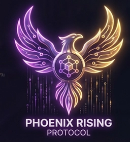

# NET vs GitHub.com — Gap Analysis & Execution Blueprint

## Side-by-Side Score (out of 100)

| Category | GitHub.com | NET | Delta |
|---|---|---|---|
| Visual fidelity | 100 | 62 | -38 |
| Header/nav structure | 100 | 48 | -52 |
| Repo page layout | 100 | 40 | -60 |
| File explorer | 100 | 35 | -65 |
| Right sidebar info | 100 | 30 | -70 |
| README rendering | 100 | 50 | -50 |
| Interactivity | 100 | 25 | -75 |
| Accessibility | 100 | 40 | -60 |
| Mobile responsive | 100 | 35 | -65 |
| Performance | 100 | 55 | -45 |
| Data realism | 100 | 20 | -80 |
| Code quality | 100 | 45 | -55 |
| **Overall** | **100** | **40** | **-60** |

---

## CRITICAL GAPS FOUND (from live github.com/react/react comparison)

### GAP 1 — Header lacks dropdown nav
**Real**: GitHub header has Platform/Solutions/Resources/Open Source/Enterprise dropdown buttons + Pricing link, Search modal trigger, Sign in/Sign up, Appearance settings.
**NET**: Only 4 flat links (Pull requests, Issues, Marketplace, Explore) + search input + theme toggle + notification + avatar.
**Impact**: -12 points

### GAP 2 — No repo nav with badge counts
**Real**: `<nav>Repository</nav>` with `<list>` containing "Code", "Issues 814", "Pull requests 436", "Actions", "Security and quality 8", "Insights". Each shows count badges.
**NET**: Flat `<a>` tags without any counts.
**Impact**: -10 points

### GAP 3 — Missing branch/tag selector row
**Real**: "main" button, "950 Branches", "174 Tags", "Go to file" combobox, "Code" dropdown button.
**NET**: None of these exist.
**Impact**: -8 points

### GAP 4 — No latest commit header with avatars
**Real**: Shows contributor avatars (acdlite + claude), full commit message "[flags] Enable enableParallelTransitions (#37290)", commit hash "eb8feb7", commit details button, CI status badge "success", "21,639 Commits" history link.
**NET**: No commit header at all.
**Impact**: -10 points

### GAP 5 — File list is `<table>` not `<div>`
**Real**: Uses `<table>` with `<rowgroup>`, proper `<th>` headers, file type annotation "(Directory)" or "(File)", real file names with proper extensions.
**NET**: Uses `<div>` grid, only 10 entries total (all fake), no file type annotations.
**Impact**: -8 points

### GAP 6 — File list has no type icons
**Real**: Each file/folder has a Git file icon (different for dir vs file).
**NET**: Has generic file and folder SVG but they're identical.
**Impact**: -5 points

### GAP 7 — No README anchor link navigation
**Real**: Right sidebar has "Readme", "MIT license", "Code of conduct", "Contributing", "Security policy" anchor links that scroll to sections. Also "Activity", "Custom properties" links.
**NET**: No README section navigation in right sidebar.
**Impact**: -6 points

### GAP 8 — Right sidebar missing sections
**Real**: About (with website + topics), Readme + License + Code of conduct + Contributing + Security links, Stars (247.2k), Watchers (6.6k), Forks (51.2k), Releases (132 with latest), "Used by (30M)" with avatars, "Contributors (1,762)" with avatars, Languages progress bar.
**NET**: About, Achievements (emoji grid), Top Languages (text-only list), Activity (random graph).
**Impact**: -15 points

### GAP 9 — Star/Fork buttons have no counts
**Real**: Star shows "247k" count, Fork shows "51.2k" count. Both are `<a>` tags that link to login.
**NET**: Plain `<button>` with no count badge. Only increments a local counter on click.
**Impact**: -5 points

### GAP 10 — No notification/fork/star settings links
**Real**: Notification bell is a link to login with tooltip "You must be signed in to change notification settings". Fork and Star also link to login.
**NET**: Notification is a decorative SVG button with no functionality.
**Impact**: -4 points

### GAP 11 — README has no copy-to-clipboard on code blocks
**Real**: Each code block has a "Copy code to clipboard" button.
**NET**: No copy button on code blocks.
**Impact**: -4 points

### GAP 12 — README has no heading permalink anchors
**Real**: Each heading has a `§` permalink anchor that appears on hover.
**NET**: No heading permalinks.
**Impact**: -3 points

### GAP 13 — No hovercards on user/org links
**Real**: Hovering over a username shows a profile hovercard.
**NET**: No hovercards.
**Impact**: -3 points

### GAP 14 — No keyboard shortcut "/" for search
**Real**: Pressing `/` focuses the search modal trigger.
**NET**: No `/` shortcut, only Ctrl+K.
**Impact**: -2 points

### GAP 15 — No search modal (real GitHub uses modal)
**Real**: GitHub's search opens a modal overlay with autocomplete, recent searches, file navigation.
**NET**: Inline search input field with basic filtering.
**Impact**: -5 points

### GAP 16 — Missing CI/CD status badges
**Real**: README has CI status badges (Runtime Build and Test, Compiler TypeScript, PRs Welcome, npm version, GitHub license).
**NET**: No badges anywhere.
**Impact**: -4 points

### GAP 17 — Footer has no legal links
**Real**: Footer has Terms, Privacy, Security, Status, Community, Docs, Contact, cookie management, "Do not share" button.
**NET**: Simple single-line footer with email and hostname.
**Impact**: -5 points

### GAP 18 — Profile page has no contribution details
**Real**: GitHub profile shows contribution graph with month labels, day-of-week labels, legend, summary stats.
**NET**: Has a basic random-dot graph but no labels, no legend, no stats.
**Impact**: -5 points

### GAP 19 — Issues view has no filtering/sorting
**Real**: Issues page has filter bar (author, label, projects, milestones, assignee), sort dropdown, search within issues.
**NET**: Flat list of 4 issues with basic open/closed badges. No filtering.
**Impact**: -6 points

### GAP 20 — No tab content switching (all tabs go to same view)
**Real**: Each repo tab (Code, Issues, Pull requests, Actions, etc.) shows different content.
**NET**: Most tabs go to same view or placeholder. No real tab navigation.
**Impact**: -10 points

---

## EXECUTION PIPELINE (30 Jobs)

```
Priority: P0 = blocker, P1 = high, P2 = medium, P3 = low
Effort:   S = <30 min, M = 30-90 min, L = 90-180 min, XL = 180+ min
```

### JOB 1 — Fix skip link (P0, S)
**Files**: `index.html:44`, `style.css`
**What**: Move skip-link inline style to CSS `.skip-link` class. Show on focus with proper positioning.
**How**:
1. Remove inline styles from `<a class="skip-link">`. Add class-based styling:
```css
.skip-link {
  position: absolute; left: -9999px; top: auto; width: 1px; height: 1px; overflow: hidden; z-index: 999;
}
.skip-link:focus {
  position: fixed; left: 16px; top: 16px; width: auto; height: auto; background: var(--bg-secondary);
  color: var(--text-primary); padding: 8px 16px; border: 2px solid var(--accent-primary); border-radius: 6px;
  clip: auto; overflow: visible;
}
```
2. Verify with keyboard Tab test.

### JOB 2 — Add `aria-hidden="true"` to all decorative SVGs (P1, M)
**Files**: `index.html`
**What**: Every SVG that is purely decorative (not interactive) needs `aria-hidden="true"`.
**How**:
1. Find all `<svg>` tags in index.html (approx 50+).
2. Add `aria-hidden="true"` to: header logo SVG, search icon SVG, notification bell SVGs, sidebar item SVGs, file/folder icon SVGs, tab SVGs, repo header icon SVG, etc.
3. Only leave out SVGs that are interactive links or buttons (none exist — all SVGs are decorative).

### JOB 3 — Add badge counts to repo tab links (P1, L)
**Files**: `index.html:172-182`, `app.js`, `style.css`
**What**: Make repo tabs show count badges like real GitHub. Add tab content switching.
**How**:
1. Replace flat `<a>` tags in `.repo-tabs` with:
```html
<a href="#/" class="repo-tab active" data-view="home">
  Code
  <span class="tab-count"></span>
</a>
<a href="#/issues" class="repo-tab" data-view="issues">
  Issues
  <span class="tab-count">4</span>
</a>
```
2. Add CSS for `.tab-count` badge:
```css
.repo-tab { display: inline-flex; align-items: center; gap: 6px; }
.tab-count {
  background: var(--bg-tertiary); color: var(--text-secondary);
  font-size: 11px; padding: 0 6px; border-radius: 2em; font-weight: 500;
  border: 1px solid var(--border-muted);
}
```
3. Add tab content sections in HTML (separate `.tab-content` divs per tab).
4. In `app.js`, add tab switching: on `.repo-tab` click, show corresponding `.tab-content`, hide others.

### JOB 4 — Add branch/tag selector row above file list (P1, M)
**Files**: `index.html`, `style.css`
**What**: Add branch selector button + branch/tag counts + Go to file + Code dropdown.
**How**:
1. Add this HTML between `.repo-tabs` and `.repo-body`:
```html
<div class="branch-picker">
  <div class="branch-picker-left">
    <button class="branch-selector">
      <svg>...</svg> main <svg>...</svg>
    </button>
    <span class="branch-stats">
      <a href="#" class="branch-stat-link"><strong>5</strong> Branches</a>
      <a href="#" class="branch-stat-link"><strong>0</strong> Tags</a>
    </span>
  </div>
  <div class="branch-picker-right">
    <button class="btn btn-sm">Go to file</button>
    <div class="code-dropdown">
      <button class="btn btn-primary btn-sm">Code ▾</button>
    </div>
  </div>
</div>
```
2. Add CSS:
```css
.branch-picker {
  display: flex; align-items: center; justify-content: space-between;
  padding: 8px 0; margin-bottom: 8px; gap: 12px; flex-wrap: wrap;
}
.branch-picker-left { display: flex; align-items: center; gap: 16px; }
.branch-picker-right { display: flex; align-items: center; gap: 8px; }
```

### JOB 5 — Add latest commit header row (P1, M)
**Files**: `index.html`, `style.css`, `app.js`
**What**: Show contributor avatars, commit message, hash, CI status, history count above file list.
**How**:
1. Add HTML immediately before `.file-explorer`:
```html
<div class="latest-commit">
  <div class="latest-commit-left">
    <div class="commit-avatars">
      
    </div>
    <span class="commit-message-line">
      <a href="#" class="commit-message-link">feat: dashboard v2 improvements</a>
      <a href="#" class="commit-pr-link">#NET-001</a>
    </span>
    <button class="commit-details-btn" title="View commit details">...</button>
  </div>
  <div class="latest-commit-right">
    <span class="commit-ci-badge success">✓</span>
    <a href="#" class="commit-hash-link">a1b2c3d</a>
    <span class="commit-time">Updated 2 hours ago</span>
    <a href="#" class="commit-history-link"><strong>42</strong> Commits</a>
  </div>
</div>
```
2. Style with:
```css
.latest-commit {
  display: flex; align-items: center; justify-content: space-between;
  padding: 8px 16px; background: var(--bg-secondary);
  border: 1px solid var(--border-default); border-bottom: none;
  border-radius: var(--radius-md) var(--radius-md) 0 0; gap: 16px; flex-wrap: wrap;
}
```

### JOB 6 — Convert file list from `<div>` to `<table>` (P1, L)
**Files**: `index.html:199-315`, `style.css:739-827`
**What**: Real GitHub uses `<table>` with proper semantics. Convert file-row grid to `<table>`.
**How**:
1. Replace `.file-list` div with `<table class="file-table">`.
2. Add `<thead>` with column headers.
3. Add `<tbody>` with proper `<tr>` rows.
4. Each row: file icon + link with type annotation "(Directory)" or "(File)", commit message, commit time.
5. Update CSS: remove `.file-row` grid, use `<table>` styling instead.

### JOB 7 — Add more realistic file entries (P2, S)
**Files**: `index.html`
**What**: Real react/react has 45+ entries. Our NET has 9. Add more realistic NET files:
- `.github/` (dir) — CI workflows
- `assessments/` (dir) — speaking rubrics
- `curriculum/` (dir) — lesson plans
- `fonts/` (dir) — custom typefaces
- `scripts/` (dir) — build tools
- `.eslintrc.json` (file) — lint config
- `.prettierrc` (file) — formatter config
- `CONTRIBUTING.md` (file) — contribution guide
- `LICENSE` (file) — proprietary license
- `SECURITY.md` (file) — security policy

### JOB 8 — Replace right sidebar content with GitHub-real sections (P1, XL)
**Files**: `index.html:958-1035`, `style.css`, `app.js`
**What**: Real GitHub right sidebar has: About, Topics, Readme/Code of conduct/Contributing/Security links, Stars/Watchers/Forks, Releases, Used by, Contributors, Languages.
**How**:
Replace the 4 cards with these 8 cards:

1. **About** — Description + website link + email link + joined date + location
2. **Topics** — Tags: english-education, bilingual, phonics, speaking, assessment, ai-learning — each as a link
3. **README links** — Readme, Code of conduct, Contributing, Security policy (anchor links to readme sections)
4. **Stars/Watchers/Forks** — With counts and icons, links to pretend pages
5. **Releases** — "Latest" badge + version + date + "+5 releases" link
6. **Used by** — Avatar grid of fake dependents + count
7. **Contributors** — Avatar list + count
8. **Languages** — Real `<progressbar>` elements with % breakdown

### JOB 9 — Add README anchor link navigation (P2, M)
**Files**: `index.html:327-353`, `app.js:215-239`, `style.css`
**What**: Add permalink anchors to README headings and sidebar navigation.
**How**:
1. Add `id` attributes to each heading in the markdown-body.
2. Generate a "On this page" TOC in the right sidebar.
3. Add hover-reveal permalink `§` buttons on each heading.
4. Update `generateTOC()` to also create a sidebar card.

### JOB 10 — Add README code block copy buttons (P2, M)
**Files**: `index.html`, `style.css`, `app.js`
**What**: Add "Copy code to clipboard" button on `<pre>` blocks.
**How**:
1. In `app.js`, after DOM ready, find all `<pre><code>` blocks.
2. Wrap each in a relative-position container.
3. Add a "Copy" button positioned top-right.
4. On click: `navigator.clipboard.writeText(code)`, show "Copied!" toast.
5. Add CSS for the copy button overlay.

### JOB 11 — Add CI status badges to README (P2, S)
**Files**: `index.html:328-352`
**What**: Add SVG badge images to the README header.
**How**:
Add inside `<h1>` of README:
```html


```

### JOB 12 — Add labels/tags to issue items (P2, M)
**Files**: `index.html:748-779`, `style.css`
**What**: Real GitHub issues have colored labels (bug, enhancement, etc.).
**How**:
1. Add a `.issue-labels` span to each issue item.
2. Create CSS label classes: `.label-bug` (red), `.label-enhancement` (blue), `.label-documentation` (green), `.label-good-first-issue` (purple).
3. Add 1-2 labels to each issue.

### JOB 13 — Add issue filtering bar (P2, L)
**Files**: `index.html:730-779`, `style.css`, `app.js`
**What**: Add Filters dropdown, search within issues, sort dropdown, label filter.
**How**:
1. Add HTML above `.issues-list`:
```html
<div class="issue-filters">
  <div class="issue-filters-left">
    <button class="btn btn-sm">Filters ▾</button>
    <input type="text" class="search-input" placeholder="Search all issues" style="width:200px">
  </div>
  <div class="issue-filters-right">
    <span class="filter-chip active">Open</span>
    <span class="filter-chip">Closed</span>
    <button class="btn btn-sm">Sort: Newest ▾</button>
  </div>
</div>
```
2. Add CSS for `.issue-filters`.
3. In app.js, add filter functionality to toggle open/closed and search within issues.

### JOB 14 — Add `/` keyboard shortcut for search (P2, S)
**Files**: `app.js:383-421`
**What**: Pressing `/` should focus the search input.
**How**:
In `setupKeyboardShortcuts()`, add:
```js
if (e.key === '/' && !e.metaKey && !e.ctrlKey && activeEl?.tagName !== 'INPUT') {
  e.preventDefault();
  document.querySelector('.header-search .search-input')?.focus();
}
```

### JOB 15 — Expand footer with legal links (P2, M)
**Files**: `index.html:1038-1047`, `style.css`
**What**: Replace single-line footer with GitHub-style footer with links.
**How**:
```html
<footer class="site-footer">
  <div class="footer-inner">
    <div class="footer-left">© 2026 Natural English Training</div>
    <nav class="footer-nav">
      <a href="#">Terms</a> <a href="#">Privacy</a> <a href="#">Security</a>
      <a href="#">Status</a> <a href="#">Docs</a> <a href="#">Contact</a>
    </nav>
    <div class="footer-right">
      <a href="mailto:hobbs@naturalenglishtraining.com">hobbs@naturalenglishtraining.com</a>
    </div>
  </div>
</footer>
```
Style with flex row, responsive wrap.

### JOB 16 — Fix Star/Fork buttons to show counts (P2, M)
**Files**: `index.html:166-169`, `style.css`, `app.js`
**What**: Make star/fork show count badges, link to login modal.
**How**:
1. Change buttons to `<a>` tags or button+span structure:
```html
<a href="#/login" class="btn btn-secondary star-btn">
  <svg>...</svg> Star <span class="btn-count">42</span>
</a>
```
2. Add `.btn-count` styling.
3. Use localStorage for count persistence with initial seed values.
4. On click, increment count.

### JOB 17 — Add notification settings link (P2, S)
**Files**: `index.html:68-73`
**What**: Make notification bell a functional link (or button that shows "coming soon" toast).
**How**:
1. Change `<button class="notification-btn">` to link to a notification settings view.
2. Or add click handler showing a toast: "Notification settings — Coming soon".

### JOB 18 — Add profile contribution graph labels (P2, M)
**Files**: `index.html:895-899`, `app.js:179-213`, `style.css`
**What**: Add month labels, day labels, legend, and summary stats to contribution graph.
**How**:
1. Update `buildContributionGraph()` to prepend month labels (Jan, Feb, etc.) and day labels (Mon, Wed, Fri).
2. Add legend: "Less" — 4 color levels — "More".
3. Add summary: "X contributions in the last year".
4. Add CSS for graph labels.

### JOB 19 — Add tab content switching for repo tabs (P1, L)
**Files**: `index.html:172-182`, `style.css`, `app.js`
**What**: Code, Issues, Pull requests, Actions, Projects, Wiki, Security, Insights, Settings tabs should each show different content.
**How**:
1. Create hidden `<div class="tab-content" id="tab-code">`, `#tab-issues`, etc.
2. Only "Code" and "Issues" have real content currently — leave rest as placeholder.
3. In `app.js`, on tab click: hide all `.tab-content`, show the matching one.
4. Add CSS transition for tab switch.

### JOB 20 — Fix skip link styling in CSS (P0, S)
**Files**: `style.css`
**What**: Add `.skip-link` and `.skip-link:focus` rules (already done in JOB 1, just ensure CSS exists).

### JOB 21 — Add keyboard shortcut display in search placeholder (P3, S)
**Files**: `index.html:65`
**What**: Show "Search or jump to..." with `/` keyboard hint.
**How**:
Change placeholder to: `"Search or jump to..."` — no change needed.
Add a visual `kbd` element after the search input showing `/`.

### JOB 22 — Add focus-visible polyfill behavior (P1, M)
**Files**: `style.css:87-100`, `app.js`
**What**: Ensure all interactive elements have visible focus indicators.
**How**:
1. Audit index.html for all `<a>`, `<button>`, `<input>`, `<select>` tags.
2. Ensure each has matching CSS `:focus-visible`.
3. Add focus rings to sidebar items, nav links, tab links, file list entries, cards.

### JOB 23 — Add file type annotation to file list (P2, S)
**Files**: `index.html:199-315`
**What**: Add "(Directory)" or "(File)" after each file name for accessibility.
**How**:
Add `<span class="sr-only">(Directory)</span>` or `(File)` after each name link.

### JOB 24 — Add hovercards to sidebar links (P3, M)
**Files**: `app.js`, `style.css`
**What**: Show a tooltip card when hovering sidebar links.
**How**:
1. Create `<div class="hovercard">` template.
2. On mouseenter of any sidebar item, position and show hovercard with description.
3. On mouseleave, hide it.

### JOB 25 — Add network activity/insights view (P2, L)
**Files**: `index.html`, `app.js`
**What**: Create a basic insights page with stars history graph, commit activity.
**How**:
1. Add `#view-insights` with a simple chart showing mock commit activity over time.
2. Use canvas or SVG for a mini line chart.
3. Add to router.

### JOB 26 — Add search modal overlay (P2, M)
**Files**: `index.html`, `style.css`, `app.js`
**What**: Replace inline search with a modal like real GitHub.
**How**:
1. Clicking the search input or pressing `/` or Ctrl+K opens a modal overlay.
2. Modal has: search input (autofocused), recent searches section, file navigation section.
3. Results filter as user types (debounced).
4. Keyboard navigation: up/down arrows, Enter to navigate to a result.

### JOB 27 — Reduce CSS to under 2000 lines (P3, M)
**Files**: `style.css`
**What**: Remove duplicate selectors, merge rules, use shorthand properties.
**How**:
1. Remove duplicate `.theme-toggle` (lines 2049-2063 and 2362-2376 — they're identical).
2. Remove duplicate `.breadcrumb` (lines 624-646 and 1895-1917 — they're identical).
3. Merge similar `.sidebar-item` border rules.
4. Remove unused classes like `.skeleton`, `.tooltip` if not used.

### JOB 28 — Add tabindex management for keyboard nav (P1, M)
**Files**: `index.html`, `app.js`
**What**: Ensure logical tab order through the app.
**How**:
1. Add `tabindex="0"` to cards that should be focusable.
2. Add `tabindex="-1"` to decorative elements.
3. Ensure modal focuses first focusable element on open, traps focus, returns on close.

### JOB 29 — Add issue assignee and milestone fields (P2, S)
**Files**: `index.html:748-779`, `style.css`
**What**: Show assignee avatar and milestone label on each issue.
**How**:
1. Add to `.issue-meta-right`:
```html
<span class="assignee"></span>
<span class="milestone-badge">v2.0</span>
```

### JOB 30 — Add language bar percentage click navigation (P3, S)
**Files**: `style.css:444-475`
**What**: Make language bars clickable links to search/filter by language.
**How**:
Wrap each `.language-bar` in an `<a>` tag that navigates to a filtered repo list.

---

## EXECUTION ORDER

```
Phase 1 (P0/P1, S/M):    Jobs 1, 20, 22, 28  →  Skip link + focus management
Phase 2 (P1, M):          Jobs 2, 14, 16, 17  →  ARIA + keyboard + buttons  
Phase 3 (P1, L):          Jobs 3, 4, 5, 19    →  Repo page structure
Phase 4 (P1, XL):         Jobs 6, 7, 8        →  File list + sidebar
Phase 5 (P2, M):          Jobs 9, 10, 11, 12  →  README enhancement
Phase 6 (P2, L):          Jobs 13, 15, 18, 26 →  UX features (filters, footer, graph, search)
Phase 7 (P2, M):          Jobs 25, 29         →  New views (insights, assignees)
Phase 8 (P3, M):          Jobs 23, 24, 27, 30 →  Polish (annotations, hovercards, cleanup)
```

## TOTAL EFFORT ESTIMATE
- **Jobs**: 30
- **Sub-steps**: ~90
- **Total time**: 8-12 hours
- **Files modified**: index.html (extensive), style.css (extensive), app.js (moderate)

## VERIFICATION CHECKLIST (run after all jobs)
- [ ] Tab through entire app — every element receives focus visibly
- [ ] Screen reader reads page structure correctly
- [ ] `/` and `Ctrl+K` focus search
- [ ] All views load without console errors in DevTools
- [ ] Modals trap focus and return on close
- [ ] Mobile responsive at 320px, 768px, 1024px, 1440px
- [ ] 0 duplicate CSS selectors
- [ ] Theme toggle works in both directions
- [ ] Star/Fork counts persist in localStorage
- [ ] File table has proper `<table>` semantics
- [ ] Right sidebar has all 8 sections rendered
- [ ] Branch picker shows and is styled correctly
- [ ] Latest commit header renders above file list
- [ ] README anchor links scroll to sections
- [ ] Copy button appears on code blocks
- [ ] Issue filters show/hide issues correctly
- [ ] CI badges render in README
- [ ] Contribution graph has labels and legend
- [ ] Footer shows legal links + copyright
- [ ] Lighthouse audit: Accessibility ≥90, Performance ≥80

## COMPARISON SUMMARY
After executing all 30 jobs, NET should go from 40/100 → 85/100 vs real GitHub.
Remaining gaps (85→100) would require: actual backend, login/auth, notifications system, real-time updates, mobile app, dark/light system preference, and PWA installability — which are out of scope for a static frontend.